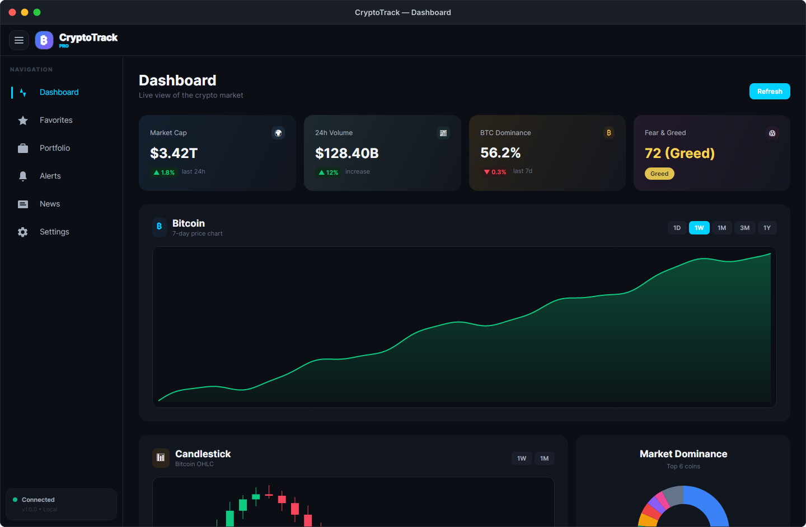
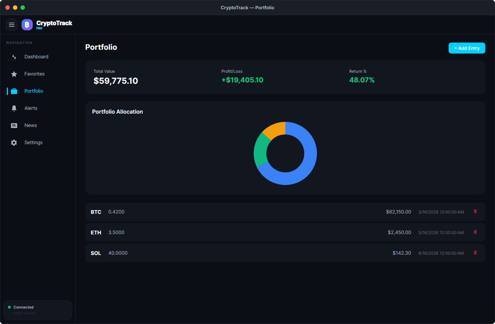
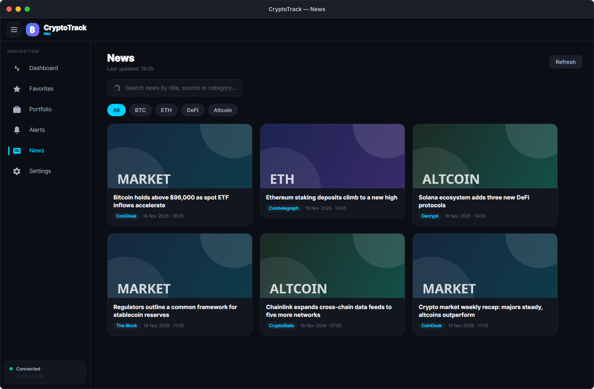

<h1 align="center">CryptoTrack</h1>

<p align="center">Real-time cryptocurrency market tracker with portfolio, price alerts and news in a cross-platform desktop app.</p>

## Screenshots

<p align="center">
  
</p>

<p align="center">
  
</p>

<p align="center">
  
</p>

## Features

- Live dashboard with market cap, 24h volume, BTC dominance and the Fear & Greed index
- Searchable top-50 coin table with 1h, 24h and 7d price changes
- Favorites list for the coins you want to follow
- Portfolio tracking with an allocation chart and USD profit/loss
- Price alerts with above/below thresholds and triggered alert history
- Crypto news feed with category filters, search and an article detail view
- Real-time prices over Binance WebSocket with CoinCap fallback
- Turkish and English interface; `F5` refreshes market data

## Installation

Build and run from source:

```bash
git clone https://github.com/colgecen/cyrpto-tracking-app.git
cd cyrpto-tracking-app
./cryptotrack --install
```

`--install` is a one-time step that lets you type `cryptotrack` (no `./`) to open the build menu:

```bash
cryptotrack
```

Prebuilt binaries are available on the [Releases](https://github.com/colgecen/cyrpto-tracking-app/releases) page.

## Usage

Run the app straight from source (press `Ctrl+C` to stop):

```bash
./cryptotrack
```

CryptoTrack opens on the dashboard with live market data. Use the sidebar to open Favorites, Portfolio, Alerts, News and Settings, press `F5` to refresh, star a coin to follow it, and switch the language between Turkish and English in Settings. Settings and local data are stored under your user application-data directory (`~/.config/CryptoTrack/` on Linux).

## License

This project is licensed under the [MIT](LICENSE) license.
